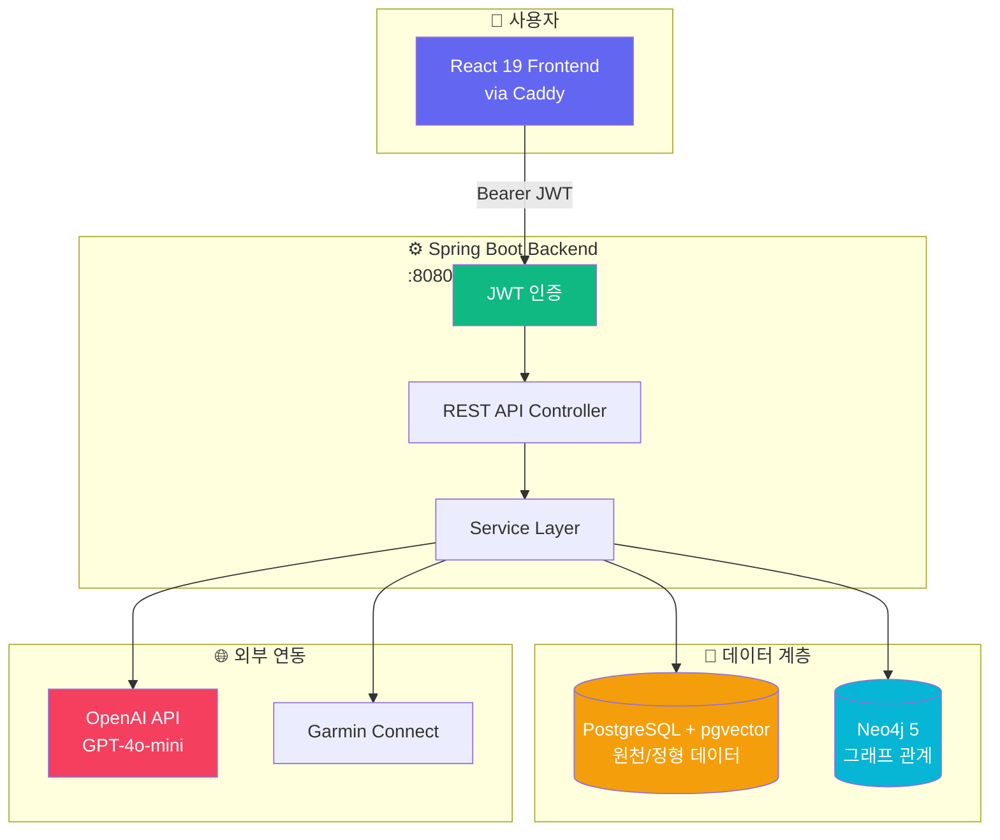

# Personal Insight OS — MVP 개발 문서

> Personal Insight OS 설계/운영 문서 모음입니다.

---

## 한눈에 보는 전체 구조



---

## 문서 목차

| # | 문서 | 내용 |
|---|------|------|
| 1 | [📐 아키텍처](architecture.md) | 시스템 구조, OAuth/MCP 흐름, 데이터 흐름, 배포 구조 |
| 2 | [🛠 기술 스택](tech-stack.md) | Backend/Frontend/MCP/Infra 스택과 버전 |
| 3 | [📡 API 명세](api-specification.md) | 엔드포인트, OAuth, 오류 규약 |
| 4 | [🗄️ DB 스키마](database-schema.md) | ERD, 테이블 요약, OAuth(V25)/V26, Neo4j 그래프 모델 |
| 5 | [🖥️ 화면 스펙](ui-screens.md) | 화면별 구성, 기능-API 매핑, 접근성 |
| 6 | [📁 프로젝트 구조](project-structure.md) | 디렉터리 트리 |
| 7 | [🚀 실행 가이드](getting-started.md) | Docker Compose 및 로컬 개발/테스트 |
| 8 | [📋 MVP 기능 체크리스트](mvp-features.md) | 기능별 구현 상세 |
| 9 | [🤖 MCP 연동](mcp-integration.md) | OAuth 2.1 연결, 도구 목록, 클라이언트 설정 |
| 10 | [🛠 운영 가이드](operations.md) | 포트, 백업/복구, 시크릿 교체, 업그레이드 |

`archive/`는 초기 기획 초안이며 더 이상 갱신하지 않습니다.

---

## 실행 한 줄 명령

```bash
cp .env.example .env   # 필수 값 채우기 (getting-started.md 참고)
docker compose up -d --build
```

| 서비스 | URL |
|--------|-----|
| 웹 앱 / API / MCP | https://localhost (Caddy, `PIOS_DOMAIN`) |
