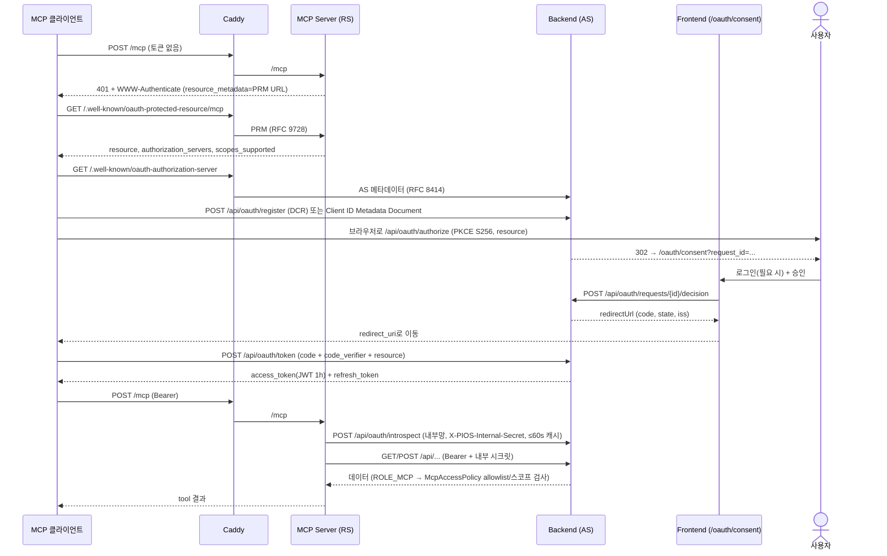
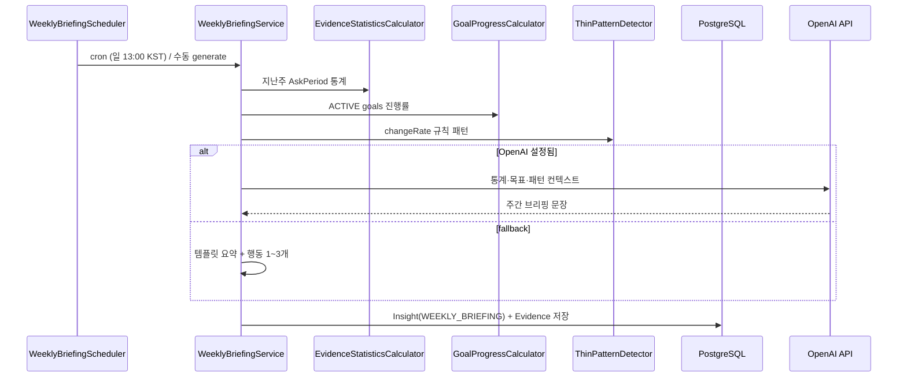
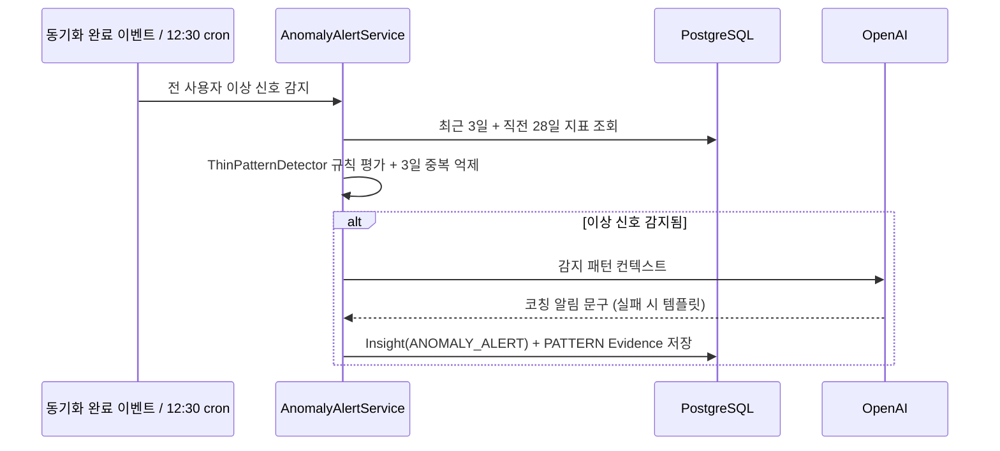
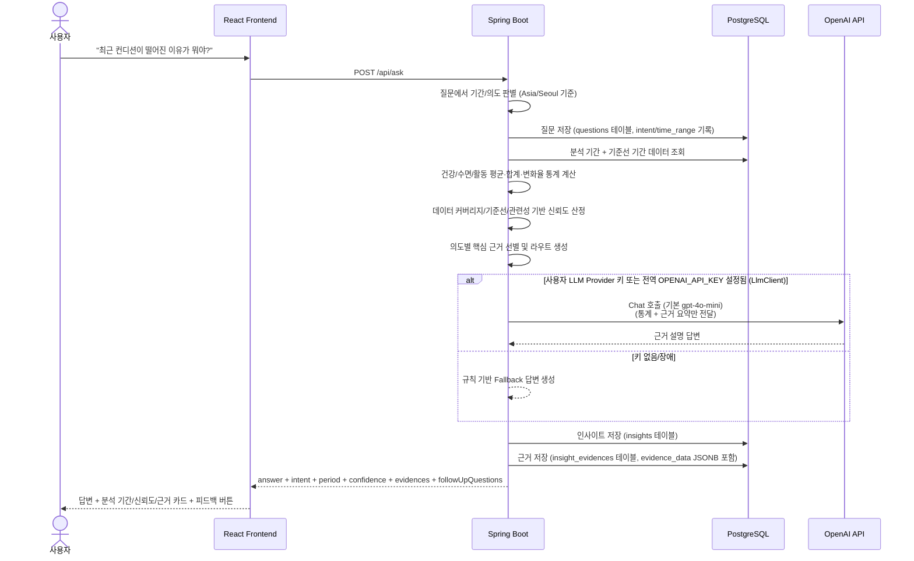
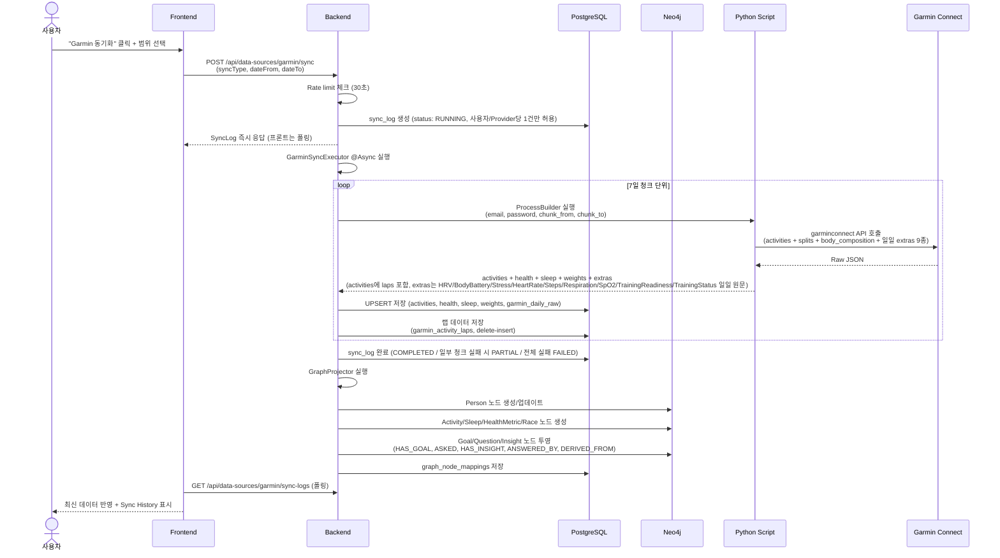
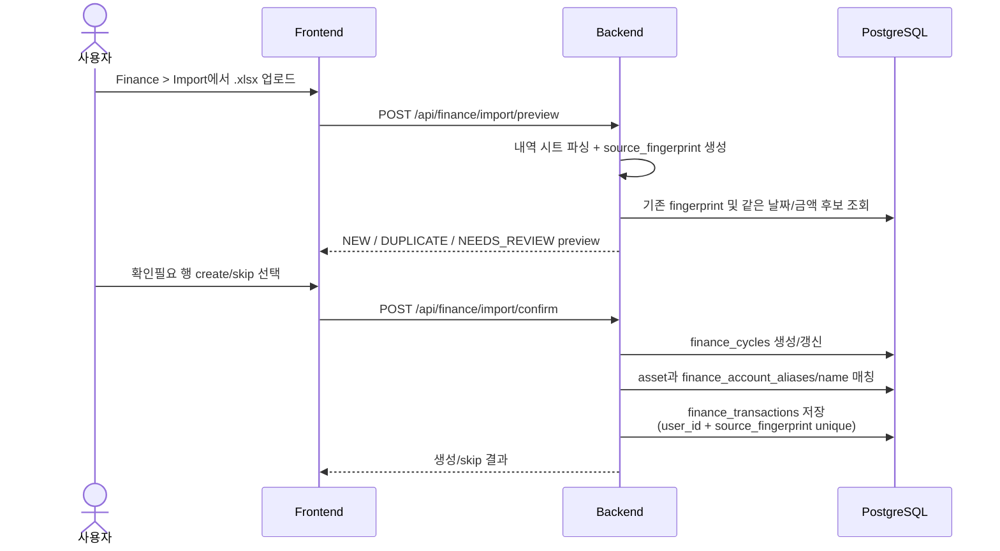
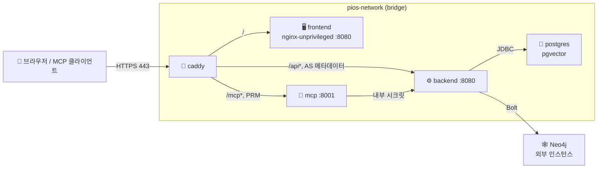

# 📐 아키텍처

## 전체 시스템 다이어그램

```mermaid
flowchart TB
    subgraph 클라이언트["🖥️ 클라이언트 (React 19)"]
        direction TB
        UI1[Login 화면]
        UI2[Dashboard 화면]
        UI3[Ask My Data 화면]
        UI4[Graph 탐색 화면]
        UI5[Settings 화면]
        Zustand[Zustand<br/>Auth Store]
        RQ[TanStack Query<br/>Server State]
    end

    subgraph 백엔드["⚙️ 백엔드 (Spring Boot 3.5)"]
        direction TB
        subgraph 보안["🔐 Security Layer"]
            JWT[JWT Filter]
            SC[SecurityConfig<br/>CORS 설정]
        end

        subgraph API["📡 REST API Layer"]
            AuthC[AuthController]
            DashC[DashboardController]
            AskC[AskController]
            GraphC[GraphController]
            DataC[DataSourceController]
            ActivityC[ActivityController]
            HealthC[HealthController]
            InsightC[InsightController]
            GoalC[GoalController]
            LLMC[LlmProviderController]
            OAuthC[OAuthController / OAuthConsentController]
            FinC[FinanceController 외]
        end

        subgraph 비즈니스["💼 Business Layer"]
            AuthS[AuthService]
            AskS[AskService<br/>RAG Pipeline]
            GraphS[GraphService]
            GraphP[GraphProjectorService]
            GarminSync[GarminSyncService]
            GarminPython[GarminPythonClient]
            SyncSchedule[SyncScheduleService]
            GarminExec[GarminSyncExecutor<br/>@Async]
            LlmClient[LlmClient<br/>사용자 키 → 전역 키]
            OAuthS[OAuth Services]
            MockS[MockDataService]
        end

        subgraph 도메인["📦 Domain Layer"]
            Entity1[User Entity]
            Entity2[GarminActivity Entity]
            Entity3[Insight Entity]
            Entity4[... 다수]
        end
    end

    subgraph 데이터["💾 데이터 계층"]
        direction TB
        PG[(PostgreSQL + pgvector<br/>Flyway V1~V27)]
        NEO[(Neo4j<br/>외부/클로드 인스턴스)]
    end

    subgraph 외부["🌐 외부 서비스"]
        OAI[OpenAI API]
        Garmin[Garmin Connect]
    end

    UI1 -->|POST /api/auth/login| AuthC
    UI2 -->|GET /api/dashboard/summary| DashC
    UI3 -->|POST /api/ask| AskC
    UI4 -->|GET /api/graph| GraphC
    UI5 -->|CRUD /api/settings| LLMC

    AuthC --> AuthS
    AskC --> AskS
    GraphC --> GraphS
    DataC --> GarminSync
    GarminSync --> GarminPython
    GarminPython --> Python[Python Script<br/>garminconnect lib]
    SyncSchedule --> GarminSync

    AuthS --> Entity1
    AskS --> Entity3
    AskS --> OAI
    GraphP --> PG
    GraphP --> NEO
    Python --> Garmin[Garmin Connect API]

    Zustand -->|Bearer Access Token| JWT
    Zustand -->|Cookie Refresh Token| AuthC
    RQ --> API

    style 클라이언트 fill:#6366f1,color:#fff
    style 백엔드 fill:#10b981,color:#fff
    style 데이터 fill:#f59e0b,color:#fff
    style 외부 fill:#f43f5e,color:#fff
```

---

## 인증 흐름 (JWT + Refresh Token)

```mermaid
sequenceDiagram
    actor U as 사용자
    participant FE as React Frontend
    participant BE as Spring Boot
    participant PG as PostgreSQL

    U->>FE: 로그인 (email, password)
    FE->>BE: POST /api/auth/login
    BE->>PG: Refresh Token SHA-256 hash 저장
    BE-->>FE: Access Token (json) + Refresh Token (HttpOnly Cookie)
    FE->>FE: Zustand에 access token 저장

    U->>FE: API 호출
    FE->>BE: Authorization: Bearer <access>
    BE-->>FE: 200 OK

    alt Access Token 만료 (401)
        FE->>BE: POST /api/auth/refresh (withCredentials)
        BE->>BE: Cookie의 refresh_token 검증
        BE->>PG: 기존 Refresh Token 삭제 (Rotation)
        BE->>PG: 새 Refresh Token 저장
        BE-->>FE: 새 Access Token + 새 Refresh Token Cookie
        FE->>BE: 원래 요청 재시도
    end

    U->>FE: 로그아웃
    FE->>BE: POST /api/auth/logout
    BE->>PG: 해당 사용자 Refresh Token 전부 삭제
    BE-->>FE: Set-Cookie: refresh_token=; Max-Age=0
    FE->>FE: Zustand 상태 초기화
```

| 구성 요소 | 설명 |
|-----------|------|
| **Access Token** | JWT (HS256), 만료 24h, `Authorization: Bearer` 헤더로 전송 |
| **Refresh Token** | JWT (HS256), 만료 7일, `HttpOnly; Secure; SameSite=Strict` 쿠키로 저장 |
| **Rotation** | Refresh 시 기존 토큰 DB에서 삭제 후 새로 발급 (재사용 공격 방지) |
| **Revoke** | 로그아웃 시 DB에서 해당 사용자의 모든 refresh token 삭제 |
| **Silent Refresh** | 프론트에서 401 수신 시 `/api/auth/refresh` 자동 호출, 성공하면 대기 중인 요청 재시도 |

---

## MCP OAuth 2.1 흐름

PIOS 백엔드가 Authorization Server(AS), MCP 서버가 Resource Server(RS)입니다. 외부 접근은 모두 Caddy를 통과합니다.



| 항목 | 설명 |
|------|------|
| Caddy 라우팅 | `/api*`, `/.well-known/oauth-authorization-server*` → backend, `/mcp*`, `/.well-known/oauth-protected-resource*` → mcp, 그 외 → frontend. **`/api/oauth/introspect*`는 404로 차단** |
| 내부 시크릿 | `PIOS_MCP_INTERNAL_SECRET`(backend/mcp 공유). 없으면 introspect 401, OAuth 토큰으로 인증된 요청도 거부 |
| 주체 제한 | OAuth 토큰/`pios_` API 키 주체는 `ROLE_MCP`. `McpAccessPolicy` allowlist(`mcp:read`/`mcp:write`) 밖 API는 403, 연결된 앱 관리 API(`/api/oauth/*`)도 호출 불가 |
| 토큰 | access JWT 1시간, refresh 30일(회전·재사용 탐지, SHA-256 해시 저장), 코드 5분 |
| 관리 | 사용자는 MCP 설정 화면의 "연결된 앱"에서 grant를 해제 (refresh token 폐기, 이후 introspect `active:false`) |

상세 설명은 [mcp-integration.md](mcp-integration.md), 엔드포인트 명세는 [api-specification.md](api-specification.md#-oauth-api-mcp-연결).

---

## 데이터 흐름 (주간 브리핑)



---

## 데이터 흐름 (이상 신호 알림)



- 스케줄 Garmin 동기화가 끝나면(`GarminSyncFinishedEvent`, 실패 제외) 해당 사용자의 감지가 즉시 실행됩니다. 12:30 KST cron은 그날 아직 감지하지 않았고 동기화 중이 아닌 사용자만 처리하는 fallback입니다. 3일 중복 억제 덕분에 중복 실행돼도 알림이 반복되지 않습니다.
- 감지 규칙은 주간 브리핑과 동일한 `ThinPatternDetector`를 재사용합니다.
- 수동 트리거: `POST /api/insights/anomaly-alerts/detect` (Insights 화면 "Detect Anomalies" 버튼).
- 생성된 알림은 Dashboard Recent Insights와 Insights 목록에 destructive 배지로 표시됩니다.

---

## 데이터 흐름 (RAG v2 파이프라인)



**RAG v2 특성**
- LLM은 백엔드가 계산한 통계와 근거를 **설명만** 하고, 수치를 재계산하지 않습니다.
- 개인 기준선 비교를 위해 분석 기간 직전 동일 길이(기본 28일)의 데이터를 활용합니다.
- 모든 날짜 계산은 `Asia/Seoul` 기준이며, 분석 기간은 최대 90일로 제한됩니다.
- `questions`/`insights.embedding`(pgvector)으로 유사 과거 인사이트를 검색해 프롬프트에 포함합니다.
- IMPORTANT/WRONG 피드백은 `FeedbackLearningService`가 Ask·주간 브리핑·이상 신호 알림 시스템 프롬프트에 주입합니다.
- 요청 전체가 하나의 트랜잭션이 아닙니다. 응답 저장 후 그래프 투영과 인사이트 임베딩은 비동기로 실행되며, 실패해도 응답에 영향을 주지 않습니다.
- LLM 호출은 `LlmClient` 경유: 사용자 LLM Provider 키/모델이 우선, 없으면 전역 `OPENAI_*` 설정, 둘 다 없으면 템플릿 fallback.
- Neo4j 그래프 데이터는 현재 retrieval에 사용하지 않습니다(시각화·관계 탐색용).

---

## 데이터 동기화 흐름



- 청크는 7일(`sync.chunk-days`)이며 청크 타임아웃은 `120s + 30s × 일수`(최대 1800s)입니다.
- 서버 재시작 시 남은 RUNNING은 `SyncLogStartupSweeper`가 FAILED로 정리하고, (청크 수 × 청크 타임아웃 + 15분)을 넘긴 RUNNING도 stale로 FAILED 처리합니다.
- 활동 날씨는 Open-Meteo forecast API, 5일 이상 지난 활동은 archive API(ERA5)를 사용합니다.
- 매일 12:00 KST 스케줄 증분 동기화 후 이상 신호 감지가 이어집니다.

---

## Finance import 흐름



Finance는 월급 입금 직후부터 다음 월급 직전까지를 `finance_cycles`로 관리합니다. 현금흐름과 소비분석이 다른 거래는 `cashflow_included`, `spending_included` 플래그와 `cashflow_amount`, `spending_amount` 분석금액으로 분리합니다. Actual Spending은 사용일 기준 소비이므로 통신비 청구액과 단말기할부금은 원금으로 포함하고, 휴대폰 소액결제 원거래는 통장에서 아직 빠지지 않은 Deferred Spending으로 별도 표시하면서 실제 소비 카테고리에 포함합니다. 계좌 간 `이체지출`은 Spending에서 제외합니다.

Transactions 탭의 시간 보정은 원본 import 멱등성과 분리된다. 사용자는 날짜는 바꾸지 않고 시:분만 수정할 수 있으며, 백엔드는 `transaction_date + HH:mm:00`을 Asia/Seoul 기준 `transaction_at`에 저장한다. fingerprint와 source row는 원본 그대로 유지되어 같은 엑셀 파일을 다시 올려도 기존 거래로 판정된다.

계좌 분석은 원본 거래의 `asset` 문자열을 감사용으로 보존한 채, 사용자가 정의한 `finance_accounts`와 `finance_account_aliases`를 통해 선택적으로 `account_id`를 연결한다. import 시 기존 계좌 name/alias가 있으면 자동 연결하고, 없으면 Accounts 탭의 unmapped asset으로 남겨 사용자가 계좌 타입과 역할을 확정한다. Account Flow는 이체 입금/출금을 포함한 은행/현금/목적자금 계좌 흐름이며, Liability Flow는 소액결제/후불 같은 미정산 부채성 흐름이다. External Cash Out은 이체와 deferred 소비를 제외한 외부 현금유출이다.

---

## 배포 아키텍처 (Docker Compose)



| 서비스 | 이미지 | 포트 | 역할 |
|--------|--------|------|------|
| caddy | caddy:2.10.2-alpine | 80/443 | 유일한 외부 진입점. 자동 HTTPS, 보안 헤더, 경로 라우팅 |
| frontend | nginxinc/nginx-unprivileged | 8080 (내부) | React 빌드 정적 서빙 (`/api` 프록시 없음) |
| backend | eclipse-temurin:21-jre-alpine + python3 | 8080 (내부) | Spring Boot, 비root(uid 10001), `garmin_tokens` 볼륨 |
| mcp | python:3.12-slim | 8001 (127.0.0.1) | MCP 서버(OAuth RS), 비root |
| postgres | ankane/pgvector (digest 고정) | 5432 (127.0.0.1) | 원천 데이터 + 벡터 저장 |

서비스는 `depends_on: service_healthy` 순서로 기동합니다. 포트/백업/업그레이드 등 운영 상세는 [operations.md](operations.md)를 참고하세요.
