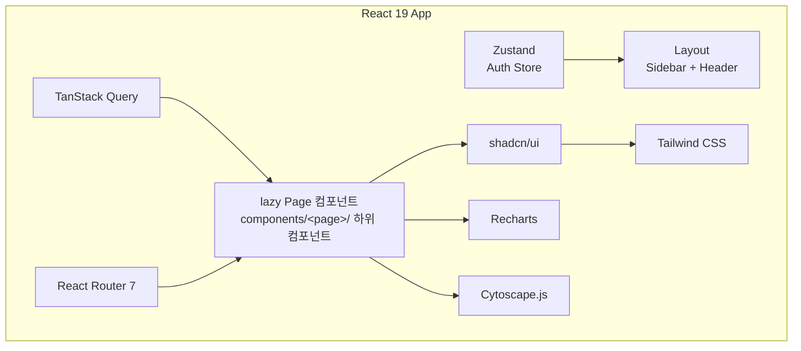
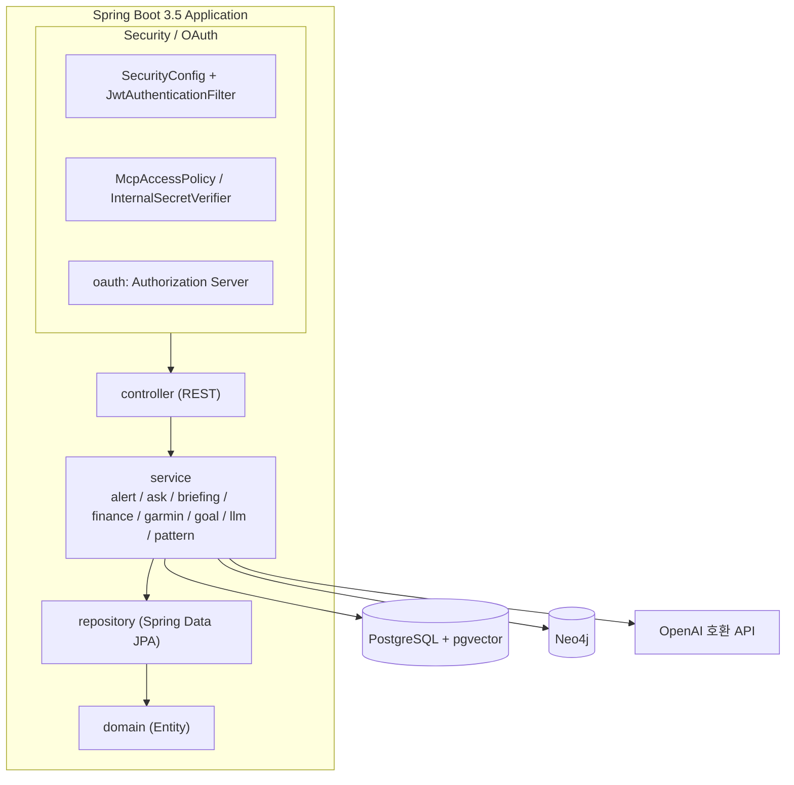

# 🛠 기술 스택

버전의 기준은 `backend/pom.xml`, `frontend/package.json`, `mcp/requirements.txt`, `docker-compose.yml`입니다 (아래는 메이저/마이너 기준).

## 전체 스택 비교표

| 영역 | 기술 | 버전 | 선택 이유 |
|------|------|------|----------|
| **Backend** | Spring Boot | 3.5.x (parent 3.5.16) | Java 생태계 표준, JPA/Security 완벽 지원 |
| | Java | 21 | LTS |
| | JJWT | 0.12.7 | 웹 로그인/OAuth access token JWT |
| | Neo4j Java Driver | 5.28.x | Neo4j 공식 드라이버 |
| | Flyway | Boot 관리 버전 | DB 마이그레이션 (V1~V26) |
| | Apache POI | 5.5.1 | 가계 엑셀 import |
| | LLM 호출 | OpenAI 호환 REST (`LlmClient`) | SDK 의존 없이 `OPENAI_BASE_URL` 교체 가능 |
| | Garmin 수집 | Python 3 + `garminconnect` 0.3.x | 비공식 Garmin Connect 클라이언트 |
| **Frontend** | React | 19.x | |
| | TypeScript | 5.9 | 타입 안전성 |
| | Vite | 8.x | 빌드/HMR, 벤더 청크 분리 |
| | React Router | 7.x (`react-router-dom`) | 라우팅, 페이지 lazy 로딩 |
| | Tailwind CSS | 3.4 | 유틸리티 기반 스타일 |
| | shadcn/ui | custom (Radix) | 커스터마이징 용이 |
| | Recharts | 3.x | 차트 |
| | Cytoscape.js + fcose | 3.35 / 2.2 | 네트워크 그래프 시각화 |
| | TanStack Query | 5.x | 서버 상태 관리 |
| | Zustand | 5.x | 클라이언트(Auth) 상태 |
| | ESLint / Vitest | 10.x / 5.x | 린트, 단위·컴포넌트 테스트 (+ Testing Library, jsdom) |
| **MCP 서버** | Python | 3.12 (SDK 요구 ≥3.10) | |
| | mcp SDK | ≥2.3, <3 (`MCPServer`) | OAuth Resource Server, streamable-http/stdio |
| | httpx / starlette / uvicorn / pydantic | 0.28 / 1.x / 0.5x / 2.12 | |
| | pytest | 8.x~9.x | 테스트 |
| **Database** | PostgreSQL + pgvector | 15.4 + 0.5.1 (이미지 digest 고정) | RDB + 벡터 검색 |
| | Neo4j | 5.x (외부 인스턴스, 선택) | 그래프 DB |
| **Infra** | Docker Compose | 5개 서비스 | postgres, backend, mcp, frontend, caddy |
| | Caddy | 2.10 | 리버스 프록시, 자동 HTTPS, 보안 헤더 |
| | nginx-unprivileged | 1.29 | 정적 SPA 서빙 (:8080) |
| | GitHub Actions / Dependabot | - | CI, 의존성 갱신 |
| **Font** | Pretendard | Variable (CDN) | 한글/영문 가독성 |

---

## Frontend 구조

- 페이지는 `lazy`로 분할되고, `vite.config.ts`의 벤더 청크(react/query/radix/charts/cytoscape/markdown)와 함께 초기 로드를 줄입니다.
- 서버 호출은 `lib/api.ts` → `lib/apiClient.ts`(401 시 refresh 후 재시도)를 통해서만 합니다.

---

## Backend 레이어 구조

구체적인 클래스 목록은 [project-structure.md](project-structure.md)를 참고하세요.
